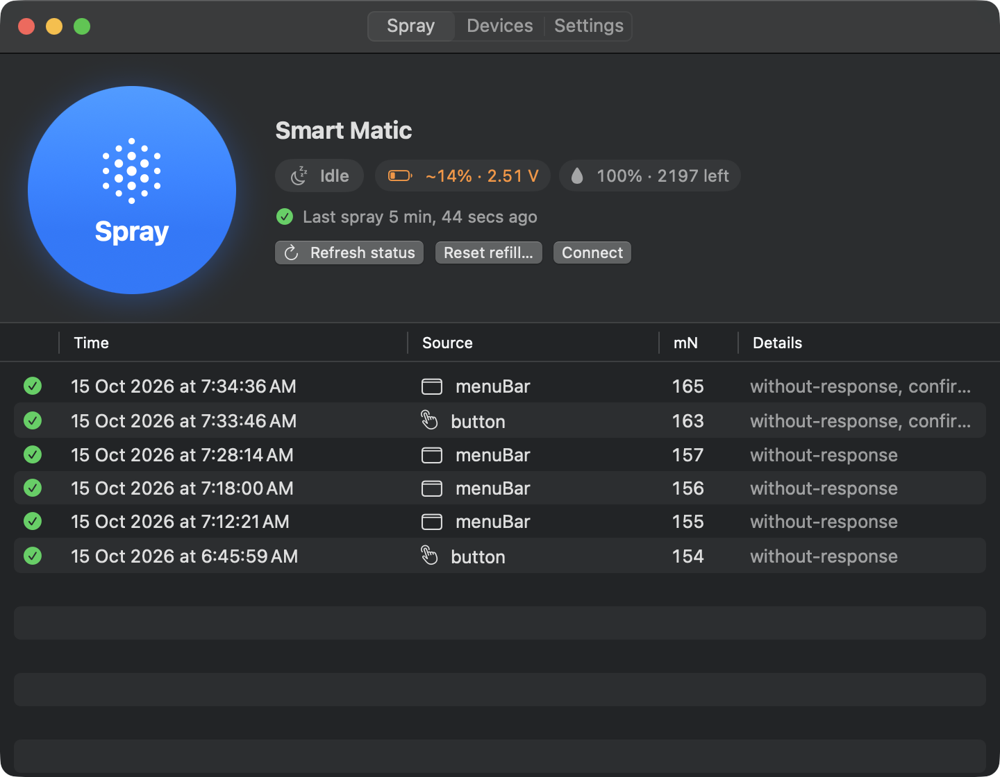
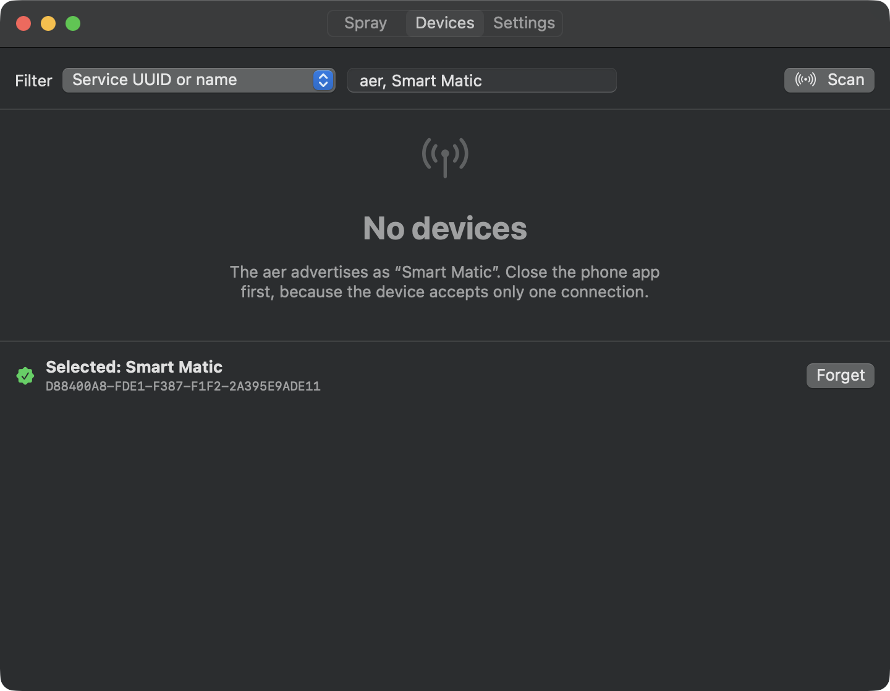
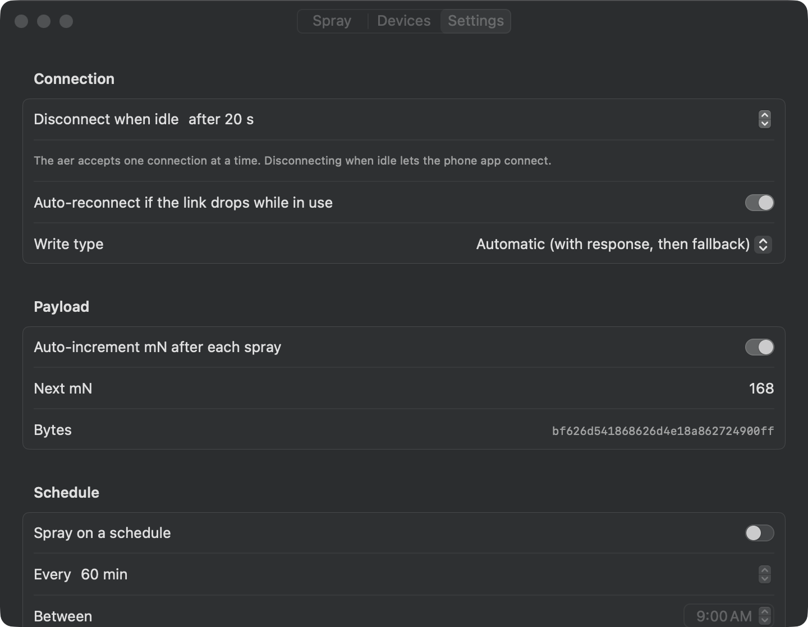

# AerControl

Desktop control for the **Godrej aer Smart Matic** Bluetooth air freshener on **macOS**
and **Windows**: a big Spray button, menu bar / tray app, schedules, a global hotkey,
Shortcuts and jump-list actions, and home-screen widgets (WidgetKit on macOS, the
Widgets Board on Windows 11).

> Not affiliated with or endorsed by Godrej. Uses the device's local BLE protocol only.

<p align="center">
  
</p>

<p align="center">
  
  
</p>

**Download:** [latest release](../../releases/latest): `AerControl-macOS.dmg`, or
`AerControl-windows-x64.zip` / `-ARM64.zip`. The apps check for updates daily.

| | macOS 14+ | Windows 10/11 |
|---|---|---|
| Scan, pick and remember a device (with RSSI) | ✅ peripheral UUID | ✅ BLE address |
| Spray button + history (time, source, success) | ✅ | ✅ |
| Connection status, auto-reconnect, idle disconnect | ✅ | ✅ |
| Schedule (every *N* min between HH:MM and HH:MM) | ✅ | ✅ |
| Global hotkey | ⌃⌥⌘S | Ctrl+Alt+Shift+S |
| Menu bar / tray, launch at login | ✅ | ✅ (left-click tray to spray) |
| Actions | Shortcuts / Siri / Spotlight: *Spray Air Freshener*, *Get Air Freshener Status* | Jump list: *Spray now* |
| Widget (small + medium) with Spray button | ✅ WidgetKit | ✅ Windows 11 Widgets Board |
| CLI (`aerctl`) | ✅ | ✅ |
| Battery (voltage + estimated %) and refill level / sprays remaining | ✅ | ✅ |
| Reset refill level after inserting a new can | ✅ | ✅ |
| Device-confirmed sprays (`ack 200`) | ✅ | ✅ |
| Update check (daily, GitHub Releases) | ✅ banner + menu bar | ✅ banner + tray notification, and App Installer auto-update |
| Log file | `~/Library/Logs/AerControl/` (in the app container when sandboxed) | app LocalFolder `\logs` |

## Before you start

**The aer accepts one Bluetooth connection at a time.** Close or disconnect the Godrej
phone app before you use AerControl. AerControl disconnects after 20 s idle by default
(*Settings › Disconnect when idle*), so the phone app can connect again.

## macOS

### Quick start (no Xcode needed)

```bash
make mac-run        # builds macos/dist/AerControl.app with SwiftPM and opens it
```

The app lives in the menu bar (🌫 icon). On first launch, open **Devices**, press
**Scan**, and pick **Smart Matic**. This dev build is ad-hoc signed and has no widget.

### Full build with the widget (Xcode 16+)

```bash
brew install xcodegen
export DEVELOPMENT_TEAM=ABCDE12345     # your Apple team id
make mac-xcode                          # generates and opens AerControl.xcodeproj
```

Run the **AerControl** scheme. Automatic signing registers the App Group
`<TEAMID>.com.aercontrol.shared` for the app and the widget extension.

**Add the widget:** right-click the desktop › *Edit Widgets…* (or open Notification
Center › *Edit Widgets*), search for **AerControl**, then drag **aer Spray** (small or
medium) onto the desktop. The widget's button asks the running app to spray. If the
app isn't running, it launches it, which is a good reason to turn on *Launch at login*.

### Signed and notarized release

```bash
xcrun notarytool store-credentials aercontrol-notary --apple-id you@example.com \
  --team-id ABCDE12345 --password <app-specific-password>
DEVELOPMENT_TEAM=ABCDE12345 make mac-release   # → macos/build/release/AerControl.{zip,dmg}
```

This needs a *Developer ID Application* certificate. See the comments in
[`macos/scripts/release.sh`](macos/scripts/release.sh). The app is sandboxed with
the Bluetooth and App Groups entitlements and the hardened runtime.

### CLI

```bash
make mac-cli
macos/.build/release/aerctl scan                 # find your device
macos/.build/release/aerctl remember <UUID>
macos/.build/release/aerctl spray                # also: --count 3 --interval 5, --mn 200
macos/.build/release/aerctl inspect              # dump the GATT table
macos/.build/release/aerctl status               # battery, refill level, firmware
macos/.build/release/aerctl refill-reset --yes   # after inserting a new refill
macos/.build/release/aerctl probe                # read every characteristic + listen (never writes)
```

`aerctl` embeds its own Info.plist and re-spawns itself as its own "responsible
process," so it works from any terminal or IDE without that app needing Bluetooth
permission.

## Windows

### Install a release

1. Download `AerControl-windows-x64.zip` (or `ARM64`) from
   [Releases](../../releases) and extract it.
2. Right-click `install.ps1` › *Run with PowerShell*. It trusts the bundled
   self-signed certificate (one admin prompt), installs the Windows App Runtime
   dependency, then installs AerControl.
3. Start **AerControl** from the Start menu. It lives in the system tray.

**Add the widget (Windows 11):** press **Win+W** › **+** (Add widgets) › **AerControl**
› **aer Spray**.

### Build it yourself

Requirements: Windows 10 19041+ (11 for widgets), Visual Studio 2022 with the
*.NET desktop* and *Windows App SDK* components, and the .NET 8 SDK.

```powershell
cd windows
.\scripts\new-dev-cert.ps1 -Trust      # once, elevated: creates + trusts CN=AerControl Dev
.\scripts\build-msix.ps1               # -> windows\dist\AerControl_x64 (MSIX) and aerctl_x64
.\dist\AerControl_x64\install.ps1
```

To develop, open `windows\AerControl.sln` in Visual Studio and run
**AerControl.App (Package)**.

The certificate subject must match `Publisher` in
`src/AerControl.App/Package.appxmanifest` (`CN=AerControl Dev`). If you use your own
certificate, change both.

### CLI

```powershell
aerctl scan
aerctl remember D8:84:00:A8:FD:E1
aerctl spray
```

## Repository layout

```
protocol/            BLE spec, field notes, shared CBOR test vectors (both test suites read them)
macos/               Swift package: AerProtocol, AerShared, AerKit (CoreBluetooth), aerctl, app
  Widget/            WidgetKit extension (built by the Xcode project from project.yml)
  App/               Info.plist, entitlements, asset catalog
windows/
  src/AerControl.Protocol    CBOR payload builder (net8.0)
  src/AerControl.Core        settings, history, schedule, BleSession state machine (net8.0)
  src/AerControl.Ble.Windows Windows.Devices.Bluetooth implementation
  src/AerControl.Cli         aerctl.exe
  src/AerControl.App         WinUI 3 app + tray + widget provider (MSIX)
  tests/                     xUnit (runs on any OS: dotnet test AerControl.Portable.slnf)
tools/gen_icons.py   dependency-free icon generator
```

## Protocol in one paragraph

Commands are indefinite-length CBOR maps written **without response** to
`6E400003-B5A3-F393-E0A9-E50E24DCCA9E` (service `6E400000-…`). Replies `{mT+50, mN,
ack:200, …}` arrive as notifications on `6E400001-…`. Spray is
`{"mT":104,"mN":154,"rI":0}` (`bf 62 6d 54 18 68 62 6d 4e 18 9a 62 72 49 00 ff`).
Live testing showed two details matter: **enable notifications** first, and **don't
disconnect immediately** after the write (both clients wait 1 s for the reply). The full
message table (from the vendor app's transcoder library) and the status layout are in
[`protocol/README.md`](protocol/README.md).

## Battery and refill level

AerControl sends the same **fetch status** query as the official app (`mT 107`; the
reply arrives on characteristic `…0001`). It shows:

* **Refill**: `% · sprays left`, computed exactly like the Godrej app. A can is rated at
  2200 sprays, counted across button presses, schedules and spray-now. After inserting
  a new can, press **Reset refill…** (or run `aerctl refill-reset --yes`) so the count
  starts again from zero.
* **Battery**: the measured voltage plus an estimated percentage. The Godrej app warns
  below 2.8 V and shows a danger icon below 2.7 V; AerControl highlights the chip in the
  same cases.

Status is read at launch, after each spray, on **Refresh status**, and otherwise at
most every 6 hours, so the phone app isn't locked out.

```bash
aerctl status
# battery:  2.51 V  (~13%, estimated)  LOW
# refill:   0%  (0 of 2200 left, 2832 sprays since reset)
# firmware: 3.0.6-T1
```

## Troubleshooting

* **"Timed out during connect"**: the phone app is probably connected. Close it, or
  turn Bluetooth off on the phone.
* **Nothing sprays but no error**: check `aerctl probe` and the log. The device needs
  the notify subscription and the settle delay described above.
* **macOS: "No Bluetooth access"**: go to System Settings › Privacy & Security ›
  Bluetooth and allow AerControl.
* **Windows widget missing**: widgets need Windows 11 and the MSIX-installed app (not
  an unpackaged debug run).

## Updates

Both apps check this repository's latest GitHub release once a day (turn this off in
*Settings › Updates*, or use **Check now**). When a newer version exists:

* **macOS** shows a banner and a menu bar button that downloads the new DMG.
* **Windows** shows a banner and a tray notification. Installs made with `install.ps1`
  go through an `.appinstaller` file, so **Windows also updates AerControl by itself**
  (checked at launch and in the background).

## Releasing

**Actions › Release › Run workflow**, then pick **patch**, **minor** or **major**
(and optional notes). The workflow:

1. bumps [`VERSION`](VERSION) and every platform manifest (`scripts/bump_version.py`),
   commits `Release vX.Y.Z` and tags it,
2. builds and tests macOS (DMG with the widget, CLI) and Windows x64 + ARM64 (signed
   MSIX, `.appinstaller`, offline zip, CLI),
3. publishes the GitHub release with generated notes. Installed apps pick it up
   through their update check.

One-time setup (repository secrets):

| Secret | Purpose |
|---|---|
| `WINDOWS_CERT_PFX`, `WINDOWS_CERT_PASSWORD` | **Required for releases.** Persistent MSIX signing certificate (subject `CN=AerControl Dev`). Updates only install when every release is signed with the same certificate. |
| `MACOS_CERT_P12`, `MACOS_CERT_PASSWORD`, `APPLE_TEAM_ID`, `APPLE_ID`, `APPLE_APP_PASSWORD` | Optional. With these, the DMG is Developer ID-signed and notarized; without them it's ad-hoc signed (right-click › Open on first launch). |

Locally: `python3 scripts/bump_version.py minor` does the same version bump.

## Development

```bash
make test            # Swift + .NET unit tests (the .NET ones run on macOS/Linux too)
```

CI ([`.github/workflows`](.github/workflows)) builds and tests both platforms on every
push. Releases go through the Release workflow above.

Deep links (macOS): `aercontrol://spray`, `aercontrol://open?tab=spray|devices|settings`.

## License

MIT. See [LICENSE](LICENSE).
